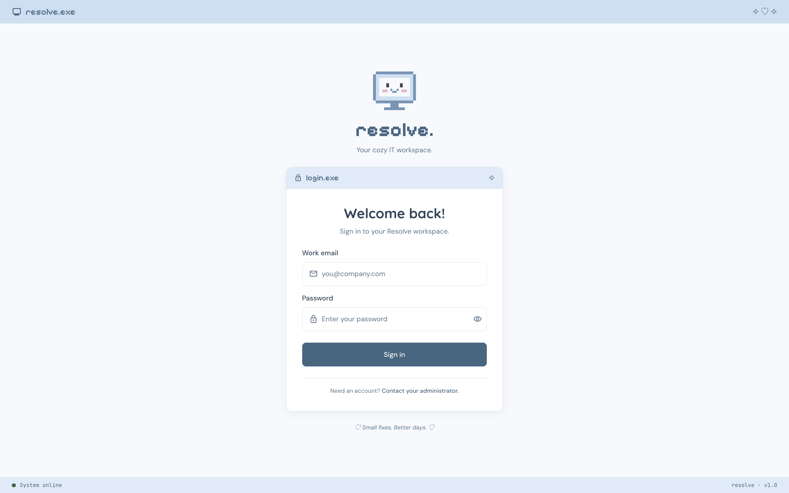
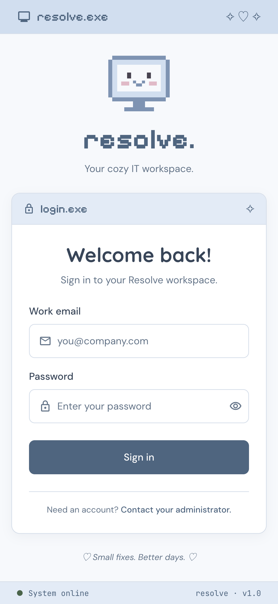

<div align="center">


# resolve.

**Your cozy IT workspace.**

A little retro, a little cozy, and a whole lot of problem-solving.

*Small fixes. Better days. ♡*


</div>

---

## About

Resolve is a full-stack IT service desk application in development, designed to streamline internal technical support, incident tracking, and ticket management.

It's designed to help employees submit support requests, IT technicians manage tickets, and administrators oversee system operations — all within one workspace.

I wanted to build something practical while incorporating a little bit of my personality into it. Who says IT support software has to look boring?

## Design

Resolve's UI follows an original design inspired by retro computers, soft pastels, and cozy games. A little bit of me in every pixel. ♡

The goal is simple: make technical work feel a little more approachable without sacrificing functionality.

## Meet Pip! ♡

Pip is Resolve's little pixel-art computer mascot, named after Python's package installer, `pip`. A little companion for all your troubleshooting adventures.

## Current Status

Currently in development! I'm building Resolve from scratch, learning along the way, and gradually integrating backend services, security features, and cloud infrastructure.

---

## Preview

### Sign In

<div align="center">
  
  
</div>

### Overview Dashboard

*Coming soon!*

## Tech Stack

| Layer | Technologies | Status |
|---|---|---|
| Frontend | React, TypeScript, Material UI, Vite | In progress |
| Backend | Python, FastAPI | Planned |
| Database | PostgreSQL, SQLAlchemy, Alembic | Planned |
| Security | JWT, Argon2id, RBAC | Planned |
| DevOps | Docker, GitHub Actions | Planned |
| Cloud | AWS | Planned |
| Design | Figma | In progress |

## Features

### Implemented

- Sign-in interface with client-side validation
- Password visibility controls
- Dashboard layout and sidebar navigation
- Client-side routing
- Reusable UI components

### Planned

- Secure authentication and session management
- Role-based access control (RBAC)
- Support ticket creation and assignment
- Ticket prioritization and lifecycle tracking
- Search and filtering
- Ticket comments and activity history
- Dashboard analytics
- Administrative user management
- Security audit logging

## Getting Started

### Prerequisites

- Node.js 24
- npm
- Git

### Installation

```bash
git clone https://github.com/prsena/Resolve.git
cd Resolve/frontend
npm ci
npm run dev
```

### Local Development

| Page | URL |
|---|---|
| Overview | http://localhost:5173/ |
| Sign In | http://localhost:5173/login |

### Production Build

```bash
npm run build
```

> The current application is a frontend development preview. Backend authentication and persistent data are not yet connected.

## Roadmap

- [x] Project initialization
- [x] Frontend setup
- [x] Branding and UI theme
- [x] Dashboard layout and navigation
- [x] Sign-in interface
- [ ] Overview dashboard
- [ ] Ticket management
- [ ] User management
- [ ] FastAPI backend
- [ ] PostgreSQL integration
- [ ] Authentication and authorization
- [ ] Role-based access control (RBAC)
- [ ] Frontend and backend integration
- [ ] Security audit logging
- [ ] Automated testing
- [ ] Docker containerization
- [ ] CI/CD pipeline
- [ ] AWS deployment
- [ ] Logging and monitoring

## Development Log

### November 25, 2026

- Initialized the React and TypeScript frontend.
- Established Resolve's branding and application theme.
- Introduced Pip, the project's original pixel-art mascot.
- Implemented dashboard navigation and client-side routing.
- Completed the sign-in interface and reusable authentication layout.
- Successfully completed the production build.

**Up next:** Overview dashboard and ticket management.

## License

Licensed under the [MIT License](LICENSE).

---

<div align="center">


<sub>One ticket at a time. ♡</sub>

</div>
